# Dependencies — module relationships and runtime libraries

> Generated by `analysis/tools/api_map.py` from the PE import directories (static imports only). Run-time `LoadLibrary`/`GetProcAddress` usage is documented per module in `analysis/report/module-analysis.md`.

## 1. Inter-module dependencies (imports of another shipped module)

No shipped module statically imports another shipped module; the modules cooperate through COM class objects, RPC/UPnP protocols and shared registry configuration.

## 2. External DLL dependencies

| DLL | Importers | Imported functions | Role (when known) |
|---|---|---|---|
| `KERNEL32.dll` | 16 (WMPDMC.exe, WMPDMCCore.dll, WMPMediaSharing.dll, WMPNSSUI.dll…) | 998 | Win32 base API (memory, files, threads, synchronisation) |
| `msvcrt.dll` | 15 (WMPDMC.exe, WMPDMCCore.dll, WMPMediaSharing.dll, WMPNSSUI.dll…) | 542 | MSVC C runtime (legacy) |
| `ADVAPI32.dll` | 13 (WMPDMC.exe, WMPDMCCore.dll, WMPMediaSharing.dll, WMPNSSUI.dll…) | 298 | Registry, security, service control |
| `USER32.dll` | 13 (WMPDMC.exe, WMPDMCCore.dll, WMPMediaSharing.dll, WMPNSSUI.dll…) | 411 | Window/message/GDI-adjacent UI API |
| `ntdll.dll` | 12 (WMPDMC.exe, WMPDMCCore.dll, WMPMediaSharing.dll, WMPNSSUI.dll…) | 44 | NT native API (Rtl* helpers, status codes) |
| `ole32.dll` | 11 (WMPDMC.exe, WMPDMCCore.dll, WMPNSSUI.dll, WMPSideShowGadget.exe…) | 109 | COM runtime (apartment init, class objects, marshalling) |
| `OLEAUT32.dll` | 10 (WMPDMC.exe, WMPDMCCore.dll, WMPNSSUI.dll, WMPSideShowGadget.exe…) | 122 | OLE Automation (BSTR/VARIANT, DISPID invocation) |
| `SHLWAPI.dll` | 9 (WMPDMC.exe, WMPDMCCore.dll, WMPMediaSharing.dll, WMPNSSUI.dll…) | 43 | Shell lightweight utilities (paths, strings, registry helpers) |
| `SHELL32.dll` | 8 (WMPDMC.exe, WMPDMCCore.dll, WMPMediaSharing.dll, WMPNSSUI.dll…) | 32 | Shell integration |
| `GDI32.dll` | 7 (WMPDMC.exe, WMPNSSUI.dll, WMPSideShowGadget.exe, mpvis.DLL…) | 115 | Graphics device interface |
| `gdiplus.dll` | 5 (WMPDMC.exe, WMPSideShowGadget.exe, mpvis.DLL, setup_wm.exe…) | 87 | — |
| `COMCTL32.dll` | 3 (WMPNSSUI.dll, setup_wm.exe, wmpnssci.dll) | 16 | Common controls |
| `IPHLPAPI.DLL` | 2 (WMPDMCCore.dll, wmpnetwk.exe) | 12 | IP helper (interface enumeration, multicast/IGMP) |
| `MF.dll` | 2 (setup_wm.exe, wmlaunch.exe) | 2 | — |
| `MPR.dll` | 2 (setup_wm.exe, wmlaunch.exe) | 6 | — |
| `SspiCli.dll` | 2 (WMPMediaSharing.dll, wmpnssci.dll) | 2 | — |
| `USERENV.dll` | 2 (setup_wm.exe, wmpnetwk.exe) | 5 | User profile/environment |
| `WINHTTP.dll` | 2 (WMPDMC.exe, WMPDMCCore.dll) | 19 | WinHTTP HTTP client stack |
| `WS2_32.dll` | 2 (WMPDMCCore.dll, wmplayer.exe) | 6 | Winsock 2 sockets |
| `API-MS-Win-Core-LocalRegistry-L1-1-0.dll` | 1 (wmpnssci.dll) | 9 | — |
| `ATL.DLL` | 1 (setup_wm.exe) | 1 | — |
| `CRYPT32.dll` | 1 (setup_wm.exe) | 1 | CryptoAPI certificate/message functions |
| `OLEACC.dll` | 1 (WMPDMC.exe) | 5 | — |
| `POWRPROF.dll` | 1 (WMPDMC.exe) | 2 | — |
| `SETUPAPI.dll` | 1 (setup_wm.exe) | 8 | Device installation APIs |
| `Secur32.dll` | 1 (setup_wm.exe) | 1 | SSPI security providers |
| `UxTheme.dll` | 1 (WMPDMC.exe) | 17 | Visual styles |
| `VERSION.dll` | 1 (setup_wm.exe) | 3 | Version-resource query API |
| `WININET.dll` | 1 (setup_wm.exe) | 1 | WinINet HTTP/FTP client stack |
| `WINMM.dll` | 1 (mpvis.DLL) | 3 | — |
| `WINTRUST.dll` | 1 (setup_wm.exe) | 3 | — |
| `WSOCK32.dll` | 1 (wmpnetwk.exe) | 3 | — |
| `WTSAPI32.dll` | 1 (wmpnetwk.exe) | 3 | Terminal Services / session API |
| `WindowsCodecs.dll` | 1 (WMPDMC.exe) | 1 | — |
| `dwmapi.dll` | 1 (WMPDMC.exe) | 1 | Desktop Window Manager composition |
| `pdh.dll` | 1 (setup_wm.exe) | 5 | — |
| `urlmon.dll` | 1 (setup_wm.exe) | 2 | URL moniker / download stack |
| `wmpdui.dll` | 1 (WMPDMC.exe) | 38 | — |

## 3. Dependency graph

```mermaid
graph LR
  WMPDMC_exe["WMPDMC.exe"]
  WMPDMCCore_dll["WMPDMCCore.dll"]
  WMPMediaSharing_dll["WMPMediaSharing.dll"]
  WMPNSSUI_dll["WMPNSSUI.dll"]
  WMPSideShowGadget_exe["WMPSideShowGadget.exe"]
  mpvis_DLL["mpvis.DLL"]
  setup_wm_exe["setup_wm.exe"]
  wmlaunch_exe["wmlaunch.exe"]
  wmpconfig_exe["wmpconfig.exe"]
  wmpenc_exe["wmpenc.exe"]
  wmplayer_exe["wmplayer.exe"]
  wmpnetwk_exe["wmpnetwk.exe"]
  wmpnscfg_exe["wmpnscfg.exe"]
  wmpnssci_dll["wmpnssci.dll"]
  wmprph_exe["wmprph.exe"]
  wmpshare_exe["wmpshare.exe"]
  WMPDMC_exe_mui["WMPDMC.exe.mui"]
  WMPDMCCore_dll_mui["WMPDMCCore.dll.mui"]
  WMPMediaSharing_dll_mui["WMPMediaSharing.dll.mui"]
  WMPSideShowGadget_exe_mui["WMPSideShowGadget.exe.mui"]
  mpvis_dll_mui["mpvis.dll.mui"]
  setup_wm_exe_mui["setup_wm.exe.mui"]
  wmlaunch_exe_mui["wmlaunch.exe.mui"]
  wmplayer_exe_mui["wmplayer.exe.mui"]
  wmpnetwk_exe_mui["wmpnetwk.exe.mui"]
  wmpnscfg_exe_mui["wmpnscfg.exe.mui"]
  wmpnssci_dll_mui["wmpnssci.dll.mui"]
  wmpnssui_dll_mui["wmpnssui.dll.mui"]
  sys_ADVAPI32_dll(["ADVAPI32.dll"]):::sys
  sys_GDI32_dll(["GDI32.dll"]):::sys
  sys_KERNEL32_dll(["KERNEL32.dll"]):::sys
  sys_OLEAUT32_dll(["OLEAUT32.dll"]):::sys
  sys_SHELL32_dll(["SHELL32.dll"]):::sys
  sys_SHLWAPI_dll(["SHLWAPI.dll"]):::sys
  sys_USER32_dll(["USER32.dll"]):::sys
  sys_msvcrt_dll(["msvcrt.dll"]):::sys
  sys_ntdll_dll(["ntdll.dll"]):::sys
  sys_ole32_dll(["ole32.dll"]):::sys
  WMPDMC_exe --> sys_ADVAPI32_dll
  WMPDMC_exe --> sys_KERNEL32_dll
  WMPDMC_exe --> sys_GDI32_dll
  WMPDMC_exe --> sys_USER32_dll
  WMPDMC_exe --> sys_msvcrt_dll
  WMPDMC_exe --> sys_ntdll_dll
  WMPDMC_exe --> sys_OLEAUT32_dll
  WMPDMC_exe --> sys_ole32_dll
  WMPDMC_exe --> sys_SHELL32_dll
  WMPDMC_exe --> sys_SHLWAPI_dll
  WMPDMCCore_dll --> sys_msvcrt_dll
  WMPDMCCore_dll --> sys_ntdll_dll
  WMPDMCCore_dll --> sys_KERNEL32_dll
  WMPDMCCore_dll --> sys_USER32_dll
  WMPDMCCore_dll --> sys_ADVAPI32_dll
  WMPDMCCore_dll --> sys_OLEAUT32_dll
  WMPDMCCore_dll --> sys_ole32_dll
  WMPDMCCore_dll --> sys_SHELL32_dll
  WMPDMCCore_dll --> sys_SHLWAPI_dll
  WMPMediaSharing_dll --> sys_msvcrt_dll
  WMPMediaSharing_dll --> sys_ntdll_dll
  WMPMediaSharing_dll --> sys_ADVAPI32_dll
  WMPMediaSharing_dll --> sys_USER32_dll
  WMPMediaSharing_dll --> sys_SHELL32_dll
  WMPMediaSharing_dll --> sys_SHLWAPI_dll
  WMPMediaSharing_dll --> sys_KERNEL32_dll
  WMPNSSUI_dll --> sys_msvcrt_dll
  WMPNSSUI_dll --> sys_KERNEL32_dll
  WMPNSSUI_dll --> sys_OLEAUT32_dll
  WMPNSSUI_dll --> sys_ole32_dll
  WMPNSSUI_dll --> sys_SHELL32_dll
  WMPNSSUI_dll --> sys_USER32_dll
  WMPNSSUI_dll --> sys_SHLWAPI_dll
  WMPNSSUI_dll --> sys_ADVAPI32_dll
  WMPNSSUI_dll --> sys_GDI32_dll
  WMPNSSUI_dll --> sys_ntdll_dll
  WMPSideShowGadget_exe --> sys_ADVAPI32_dll
  WMPSideShowGadget_exe --> sys_KERNEL32_dll
  WMPSideShowGadget_exe --> sys_GDI32_dll
  WMPSideShowGadget_exe --> sys_USER32_dll
  WMPSideShowGadget_exe --> sys_msvcrt_dll
  WMPSideShowGadget_exe --> sys_OLEAUT32_dll
  WMPSideShowGadget_exe --> sys_ole32_dll
  WMPSideShowGadget_exe --> sys_SHLWAPI_dll
  mpvis_DLL --> sys_msvcrt_dll
  mpvis_DLL --> sys_ntdll_dll
  mpvis_DLL --> sys_KERNEL32_dll
  mpvis_DLL --> sys_ADVAPI32_dll
  mpvis_DLL --> sys_ole32_dll
  mpvis_DLL --> sys_OLEAUT32_dll
  mpvis_DLL --> sys_USER32_dll
  mpvis_DLL --> sys_GDI32_dll
  setup_wm_exe --> sys_ADVAPI32_dll
  setup_wm_exe --> sys_KERNEL32_dll
  setup_wm_exe --> sys_GDI32_dll
  setup_wm_exe --> sys_USER32_dll
  setup_wm_exe --> sys_msvcrt_dll
  setup_wm_exe --> sys_ntdll_dll
  setup_wm_exe --> sys_ole32_dll
  setup_wm_exe --> sys_OLEAUT32_dll
  setup_wm_exe --> sys_SHELL32_dll
  setup_wm_exe --> sys_SHLWAPI_dll
  wmlaunch_exe --> sys_ADVAPI32_dll
  wmlaunch_exe --> sys_KERNEL32_dll
  wmlaunch_exe --> sys_USER32_dll
  wmlaunch_exe --> sys_msvcrt_dll
  wmlaunch_exe --> sys_ntdll_dll
  wmlaunch_exe --> sys_ole32_dll
  wmlaunch_exe --> sys_OLEAUT32_dll
  wmlaunch_exe --> sys_SHELL32_dll
  wmlaunch_exe --> sys_SHLWAPI_dll
  wmpconfig_exe --> sys_KERNEL32_dll
  wmpconfig_exe --> sys_msvcrt_dll
  wmpconfig_exe --> sys_ole32_dll
  wmpenc_exe --> sys_ADVAPI32_dll
  wmpenc_exe --> sys_KERNEL32_dll
  wmpenc_exe --> sys_USER32_dll
  wmpenc_exe --> sys_msvcrt_dll
  wmpenc_exe --> sys_ole32_dll
  wmpenc_exe --> sys_OLEAUT32_dll
  wmplayer_exe --> sys_ADVAPI32_dll
  wmplayer_exe --> sys_KERNEL32_dll
  wmplayer_exe --> sys_USER32_dll
  wmplayer_exe --> sys_ntdll_dll
  wmpnetwk_exe --> sys_ADVAPI32_dll
  wmpnetwk_exe --> sys_KERNEL32_dll
  wmpnetwk_exe --> sys_msvcrt_dll
  wmpnetwk_exe --> sys_USER32_dll
  wmpnetwk_exe --> sys_OLEAUT32_dll
  wmpnetwk_exe --> sys_ole32_dll
  wmpnetwk_exe --> sys_SHLWAPI_dll
  wmpnetwk_exe --> sys_ntdll_dll
  wmpnscfg_exe --> sys_msvcrt_dll
  wmpnscfg_exe --> sys_ntdll_dll
  wmpnscfg_exe --> sys_ADVAPI32_dll
  wmpnscfg_exe --> sys_KERNEL32_dll
  wmpnssci_dll --> sys_msvcrt_dll
  wmpnssci_dll --> sys_ntdll_dll
  wmpnssci_dll --> sys_USER32_dll
  wmpnssci_dll --> sys_SHLWAPI_dll
  wmpnssci_dll --> sys_GDI32_dll
  wmpnssci_dll --> sys_SHELL32_dll
  wmpnssci_dll --> sys_KERNEL32_dll
  wmprph_exe --> sys_ADVAPI32_dll
  wmprph_exe --> sys_KERNEL32_dll
  wmprph_exe --> sys_GDI32_dll
  wmprph_exe --> sys_USER32_dll
  wmprph_exe --> sys_msvcrt_dll
  wmprph_exe --> sys_ntdll_dll
  wmprph_exe --> sys_ole32_dll
  wmprph_exe --> sys_OLEAUT32_dll
  wmprph_exe --> sys_SHELL32_dll
  wmpshare_exe --> sys_KERNEL32_dll
  wmpshare_exe --> sys_msvcrt_dll
  classDef sys fill:#eee,stroke:#999
```

Only system DLLs imported by six or more modules are expanded in the graph to keep it readable; the full table in section 2 is authoritative.

